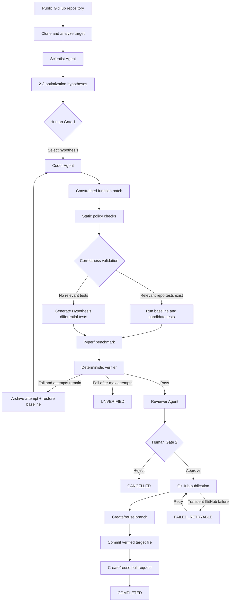

# ProofPatch

**Evidence-backed Python performance optimization with human approval before GitHub publication.**

ProofPatch analyzes a public Python repository, proposes optimization hypotheses, and generates a constrained function patch. It validates correctness in Docker, measures performance with Pyperf, and applies deterministic acceptance rules before a human can publish the result as a GitHub pull request.

**LLM proposes. The harness decides. The human controls publication.**

## Why ProofPatch?

A generated optimization can change behavior, introduce unsafe side effects, or claim an unmeasured speedup. ProofPatch treats generated code as a hypothesis to test and separates responsibilities:

| Layer | Responsibility |
| --- | --- |
| LLM agents | Propose hypotheses, generate candidate code, summarize evidence |
| Deterministic harness | Enforce policy, validate correctness, benchmark, verify acceptance |
| Human operator | Choose the optimization direction and approve publication |

## Workflow architecture



`FAILED_RETRYABLE` is a publication sub-state (`state_json.pr.status`), while the run remains `CREATING_PR`. Repository, infrastructure, or unsupported-operation errors stop the run as `FAILED`.

## Core behavior

- **Two human gates:** select one of 2–3 hypotheses at `WAITING_FOR_CANDIDATE`, then review the evidence and approve or reject publication at `WAITING_FOR_PR_APPROVAL`.
- **Bounded retries:** at most two Coder attempts. Rejected attempts retain their evidence and failure reason; the original function is restored before retrying, so each candidate uses the same baseline.
- **Static policy:** constrain changes to the target function/file and reject forbidden calls, imports, and side effects such as arbitrary file access, networking, subprocess execution, `eval`, and `exec`.
- **Correctness:** run relevant repository tests against both baseline and candidate. If none exist, generate temporary Hypothesis differential tests using supported annotations. A failing baseline is a repository/environment failure, not a rejected optimization.
- **Measured performance:** compare baseline and candidate medians with Pyperf. The default required improvement is **10%**, configurable through `PERFORMANCE_THRESHOLD_PERCENT`.
- **Deterministic acceptance:** policy, correctness, and performance must all pass. The non-LLM verifier decides acceptance; the Reviewer explains the change, results, risks, and recommendation.
- **GitHub publication:** after explicit approval, use the repository's default branch and create or reuse a branch, commit, and PR. Retryable GitHub failures preserve the verified candidate and retry only publication.
- **Inspectable outcomes:** the frontend shows hypotheses, attempt history, evidence, events, and a terminal report with real backend results. Successful reports include what changed, recorded safety checks, and the PR link.

Measured improvement is `(baseline median − candidate median) / baseline median × 100`. It applies to that candidate, workload, environment, and run—not to ProofPatch universally.

### Terminal outcomes

| Status | Meaning |
| --- | --- |
| `COMPLETED` | A verified candidate was published as a GitHub PR |
| `UNVERIFIED` | No candidate met all requirements within the allowed attempts |
| `FAILED` | Repository, infrastructure, unsupported-operation, or internal workflow failure |
| `CANCELLED` | The operator intentionally stopped the run |

Terminal runs are eligible for workspace cleanup. Retryable publication failures keep the workspace available for recovery.

## Stack and project structure

| Area | Technologies |
| --- | --- |
| Backend | FastAPI, Pydantic, async SQLAlchemy, PostgreSQL, LangGraph, Python AST |
| LLM providers | Gemini, Ollama, and a structured provider interface with recognized-error fallback |
| Evaluation | Docker, pytest, Hypothesis, Pyperf, deterministic verifier |
| Frontend | Next.js App Router, React, TypeScript, Tailwind CSS, native fetch |
| Publication | GitHub REST API |

```text
ProofPatch/
├── backend/
│   ├── app/
│   │   ├── agents/          # Scientist, Coder, Reviewer
│   │   ├── api/             # FastAPI routes
│   │   ├── context/         # Agent context and retry feedback
│   │   ├── llm/             # Provider implementations
│   │   ├── repository/      # Analysis, patching, GitHub, workspaces
│   │   ├── policy/          # Static change restrictions
│   │   ├── sandbox/         # Tests and benchmarks
│   │   ├── verification/    # Deterministic acceptance
│   │   ├── services/        # Persistence and state transitions
│   │   ├── models/          # Runs, events, approvals, evidence
│   │   └── workers/         # Workflow execution and cleanup
│   └── tests/
├── frontend/
│   ├── app/                 # Pages and server-side API proxy
│   ├── components/proofpatch/
│   ├── lib/proofpatch/       # Typed client, state, formatting
│   └── tests/
├── sandbox/Dockerfile
├── proofpatch-demo-target/
├── docker-compose.yml
└── .env.example
```

PostgreSQL stores runs, events, hypotheses, approvals, validation, and benchmarks. `Run.state_json` provides the evolving workflow checkpoint, including current evidence, attempt history, review, publication state, errors, and resource usage.

The browser uses `/api/proofpatch/*`; the Next.js server proxies allowlisted operations to FastAPI. Backend credentials and `FASTAPI_BASE_URL` stay server-side. See [frontend documentation](frontend/README.md) for UI details and integration-verification notes.

## Local setup

Prerequisites: Python 3.12+, Node.js 24+, npm, Git, Docker, and Gemini API access or a local Ollama installation.

### 1. Clone and configure

```sh
git clone https://github.com/JastejS28/ProofPatch.git
cd ProofPatch
```

Copy `.env.example` to a root `.env`. Set the PostgreSQL credentials and `DATABASE_URL`, keeping the host port consistent with `POSTGRES_PORT`. Add your provider configuration:

```dotenv
LLM_PROVIDER=gemini_ollama
GEMINI_API_KEY=your_key_here
GEMINI_MODEL=gemini-3.5-flash
OLLAMA_MODEL=qwen3:4b
OLLAMA_HOST=http://localhost:11434
GITHUB_TOKEN=your_repository_scoped_token
```

Supported provider values are `gemini`, `ollama`, and `gemini_ollama`. The default uses Gemini with Ollama fallback for recognized provider failures. For local/fallback use, run `ollama pull qwen3:4b` and ensure Ollama is running.

Never commit real credentials. Publication requires write access to the target repository; a fine-grained GitHub token needs **Contents: read/write**, **Pull requests: read/write**, and **Metadata: read**.

### 2. Start PostgreSQL and build the sandbox

```sh
docker compose up -d postgres
docker build -t proofpatch-sandbox:latest ./sandbox
```

The sandbox image includes pytest, Hypothesis, and Pyperf.

### 3. Start the backend

```sh
cd backend
python -m venv .venv
```

Activate the environment with `./.venv/Scripts/Activate.ps1` in Windows PowerShell, or `source .venv/bin/activate` on macOS/Linux. Then:

```sh
pip install -r requirements.txt
uvicorn app.main:app --reload
```

FastAPI runs at `http://127.0.0.1:8000`; API documentation is available at `/docs` and the database health check at `/health`.

### 4. Start the frontend

In another terminal, from the repository root:

```sh
cd frontend
npm install
```

Copy `.env.example` to `.env.local` in this directory, or create `.env.local` with:

```dotenv
FASTAPI_BASE_URL=http://127.0.0.1:8000
```

Do not prefix this variable with `NEXT_PUBLIC_`.

```sh
npm run dev
```

Open `http://localhost:3000`, enter a public repository, Python file, target function, and performance concern, then follow the two human gates. For production, run `npm run build` followed by `npm start`.

## API

These are FastAPI paths. Browser requests use the Next.js proxy prefix `/api/proofpatch`.

| Method | Path | Operation / request body |
| --- | --- | --- |
| `POST` | `/runs` | Create a run; payload below |
| `GET` | `/runs/{run_id}` | Read current state and evidence |
| `GET` | `/runs/{run_id}/events` | Read the chronological audit trail |
| `POST` | `/runs/{run_id}/decision` | Select: `{"type":"candidate","value":"HYPOTHESIS_UUID"}` |
| `POST` | `/runs/{run_id}/decision` | Approve publication: `{"type":"pr_approval"}` |
| `POST` | `/runs/{run_id}/decision` | Reject publication: `{"type":"reject"}` |
| `POST` | `/runs/{run_id}/retry-pr` | Retry publication after a retryable GitHub failure |
| `POST` | `/runs/{run_id}/cancel` | Cancel at an allowed safe waiting state |

```json
{
  "repo_url": "https://github.com/owner/repository",
  "target_file": "path/to/file.py",
  "target_function": "function_name",
  "problem_description": "Describe the performance problem."
}
```

Decisions are state-gated. Duplicate or invalid actions return `409`; the backend remains authoritative. There is no list-runs endpoint.

## Development checks

From `backend`:

```sh
pytest -v
```

From `frontend`:

```sh
npm run lint
npm run typecheck
npm test
npm run build
```

The tests cover state transitions, policy and verification, retries, repository analysis, workspace cleanup, API behavior, publication handling, and frontend outcomes. Passing unit tests does not replace a live end-to-end check with a supported target repository.

## Security and V1 boundaries

Model authority is limited to proposing, coding, and explaining. Acceptance and publication permissions come from deterministic checks and explicit human decisions. Docker execution uses disabled networking, read-only mounts, a non-root user, dropped capabilities, `no-new-privileges`, resource limits, execution timeouts, and a restricted temporary filesystem.

V1 supports public GitHub Python repositories and function-level patches. Differential testing supports a limited annotation subset such as `int`, `float`, `bool`, `str`, and supported `list[T]` inputs; unsupported signatures and async differential targets fail cleanly. Repository tests must be runnable in the sandbox, and benchmark results depend on its workload and environment.

Other boundaries: two Coder attempts, repository write access required for PR publication, no general fork/upstream contribution flow, no authentication or multi-user model, in-process background tasks rather than a durable queue, and no automatic PR merge.

## Future directions

Durable workers and restart recovery; GitHub App integration and fork support; richer correctness strategies; benchmark noise analysis and memory measurement; carefully expanded patch scope; alternate-hypothesis recovery; and structured tracing and worker observability.
